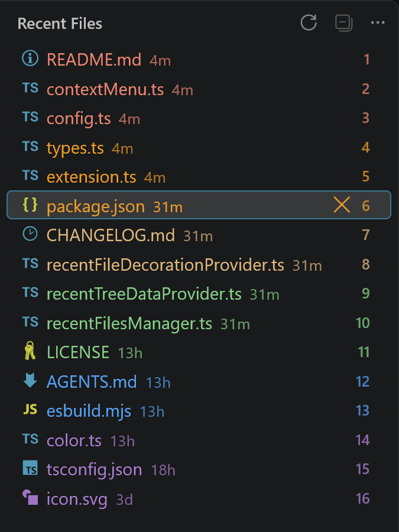
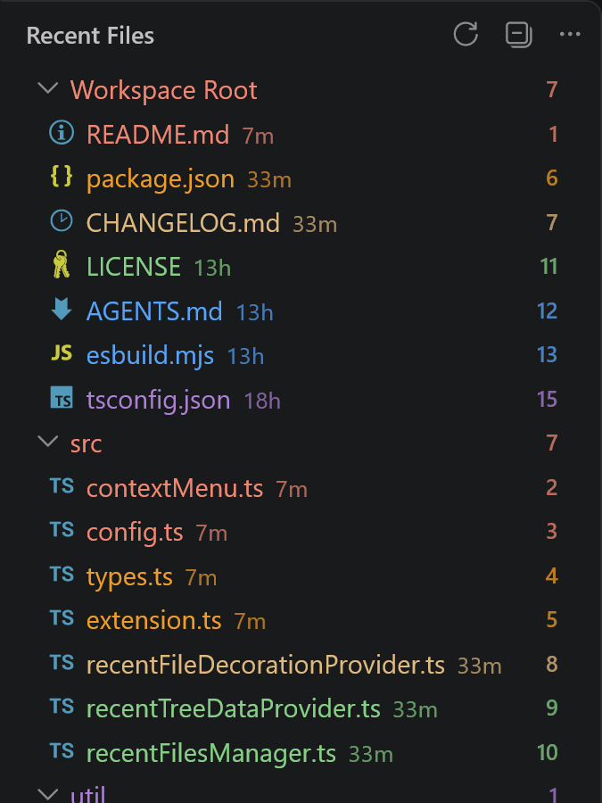
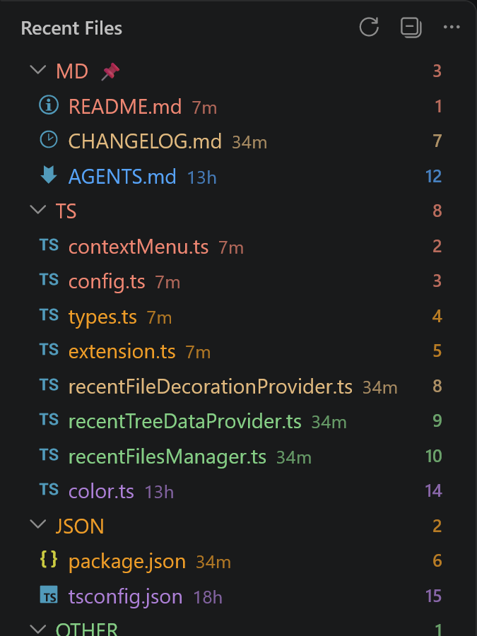
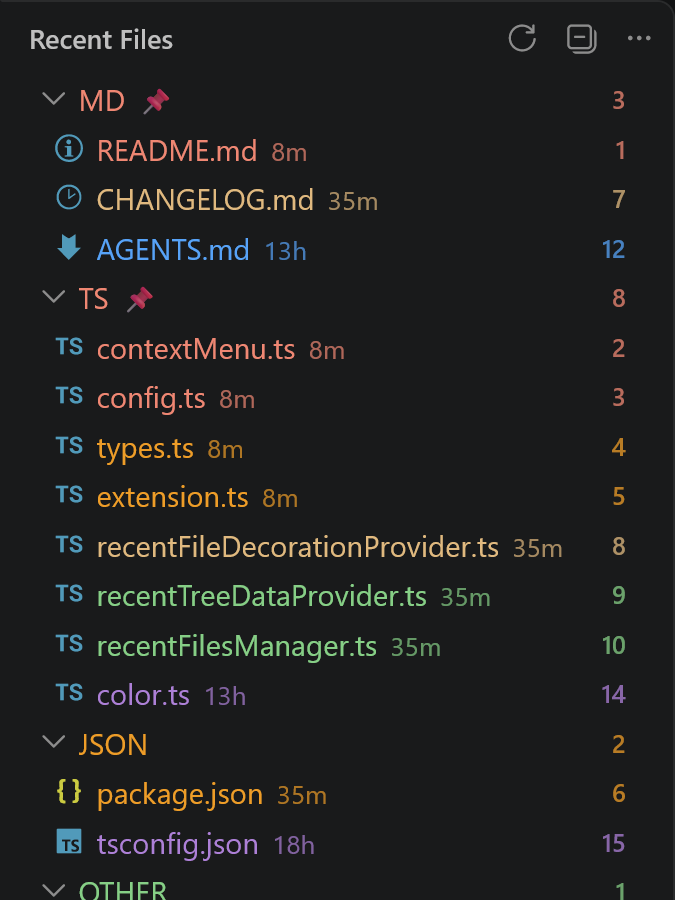
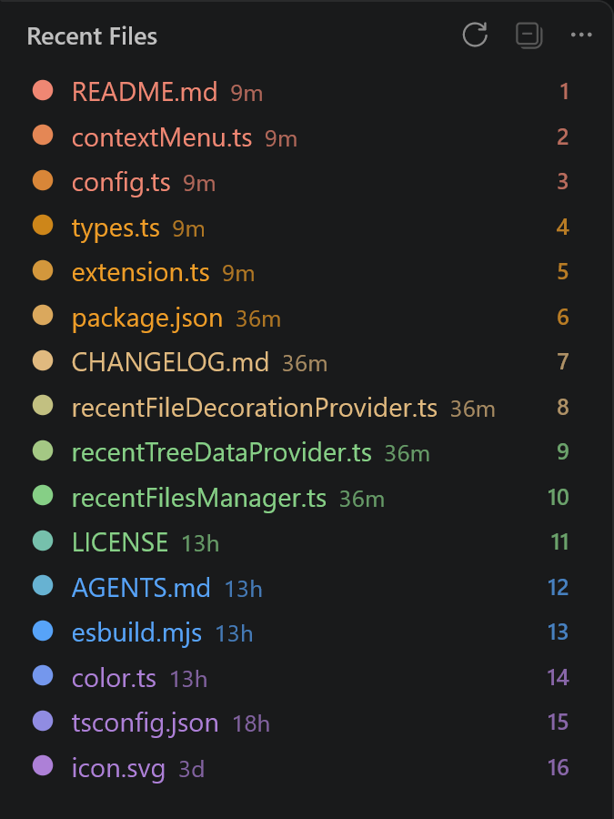
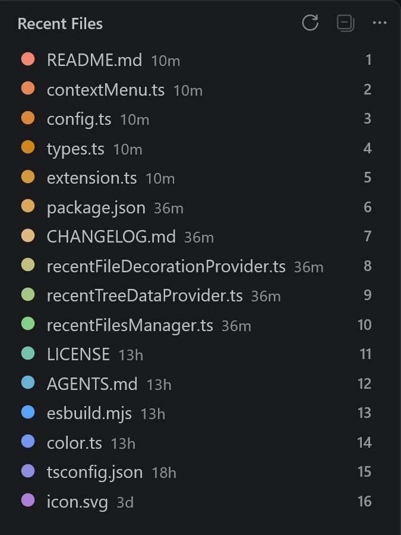
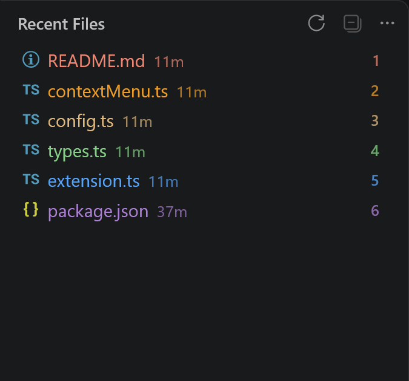
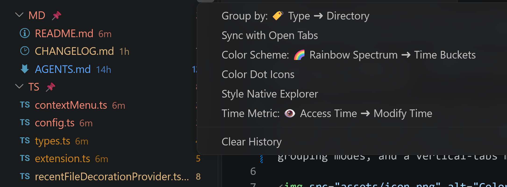
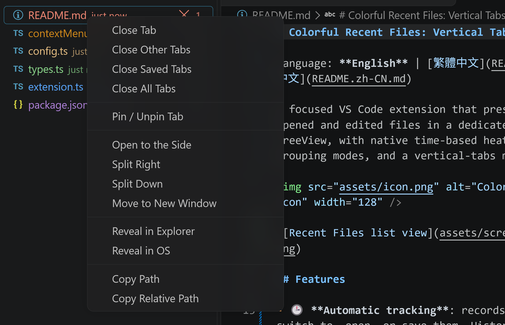

# Colorful Recent Files：垂直分页与历史记录

语言： [English](README.md) | [繁體中文](README.zh-TW.md) | **简体中文**

在专属的 Activity Bar TreeView 中呈现你最近打开与编辑过的文件，支持原生时间热度装饰、三种分组模式与垂直分页模式。




## 功能

- 🕒 **自动追踪**：切换、打开或保存文件时自动记录。历史保存在 `workspaceState`，无网络访问、无外部服务。
- 📑 **垂直分页（Sync with Open Tabs）**：开启后视图**只列出当前已打开的编辑器分页**，可作为快速垂直分页栏使用。从视图关闭分页也会关闭对应的编辑器分页；历史访问记录会完整保留，关闭同步后重新出现。
- 📁 **三种分组模式**：
  - **Flat（不分组）**——单一最近文件列表。
  - **Directory（目录）**——按文件夹路径分组。
  - **Type（类型）**——按扩展名大写分组（`TS`、`JSON`、`MD`、`OTHER`）。纯数字扩展名按长度分桶：1–3 位、4–6 位、7 位以上。
- 📌 **可 Pin 分组与手动排序**：将鼠标移到 Folder／Type 分组行上，点击右侧浮现的 inline Pin 按钮即可固定。已 Pin 分组会置顶、显示 📌 标记，并保留可拖拽调整的手动顺序。未 Pin 分组一律接续在已 Pin 区块之后，按最近活动时间排序（跟随 Time Metric 设置）。
- 🎨 **三种配色方案**：`rankSpectrum`（默认，按序号的平滑彩虹）、`timeBucket`（按时间级距）、`plainText`（中性文字，仅保留彩色圆点）。
- 🖱️ **多选与拖出**：用 `Ctrl`／`Cmd` 或 `Shift` 多选文件后，拖到编辑器或任何接受 `text/uri-list` 的目标。传递的是标准 `file:` URI（每行一个、以 CRLF 分隔、已去重），目标端拿到的是真实文件系统路径。
  - **不支持：拖入原生文件资源管理器（File Explorer）**。这是 VS Code 平台的硬性限制，不是本扩展的缺陷——原生 Explorer 在 `dragover` 阶段就拒绝任何同窗口的树状拖拽（`workbench.desktop.main.js` 中的 `if (o instanceof Lvt) return !1;`），任何 MIME 或 `resourceUri` 调整都无法绕过。要在文件夹之间移动文件，请在 Explorer 内使用剪切／粘贴。
- 🗂️ **完整右键菜单**：Sync 模式下提供与编辑器分页一致的关闭／固定／拆分／移动操作，另有在 Explorer 中显示、打开终端、在文件夹中查找、复制路径等。
- 🎨 **原生位置装饰（可选）**：开启 **Style Native Explorer** 会把同样的热度颜色套用到原生 Explorer 树与编辑器分页。

## 截图

| 列表视图 | 目录分组 | 类型分组 |
|---|---|---|
|  |  |  |

| 已 Pin 分组 | 彩色圆点图标 | 纯文本配色 |
|---|---|---|
|  |  |  |

| 垂直分页模式 | 视图菜单 | 右键菜单 |
|---|---|---|
|  |  |  |

## 序号只出现一次

文件项的说明**只显示相对时间**（例如 `just now`、`11m`、`13h`）。序号由行最右侧的原生 `FileDecoration` badge 呈现，**不会在文字中重复**。

开启 **Style Native Explorer** 时，同样的装饰也会套用到原生 Explorer 与编辑器分页，但**只有颜色、不显示序号 badge**，因此不会与文件诊断或 Git 状态标记冲突。

## 视觉风格：原生图标 vs 彩色圆点

1. **原生文件图标（默认）**：保留你的 VS Code 文件图标主题（Seti、Material 等）。新旧程度由装饰颜色与序号 badge 呈现。
2. **彩色圆点图标**（`showColorDotIcon`）：把视图中的文件图标换成平滑的 SVG 彩色圆点。圆点颜色以分段线性插值计算，并自动适应浅色与深色主题。

启用方式：

- **设置 UI**：打开设置（`Ctrl+,`／`Cmd+,`），搜索 `Colorful Recent Files: Show Color Dot Icon`，勾选即可。
- **`settings.json`**：
  ```json
  "codeColorfulRecentFiles.showColorDotIcon": true
  ```

## 如何理解视图菜单

视图标题的 `...` 菜单使用两种表示法：

- **多选项条目**（`Name: <emoji> 当前值 ➜ 下一个值`）：**emoji 标示当前值**；箭头后面是**点击后会切换到的值**，切到最后一项后会回到第一项。
  - `Group by: ✖️ None ➜ Type` → 当前是 *None*，点击切换为 *Type*。
  - 适用条目：Group by、Color Scheme、Time Metric。
- **开关条目**（`Name`／`Name <emoji>`）：**末尾的 emoji 代表已启用**，没有 emoji 代表已停用。点击即切换。
  - `Sync with Open Tabs` → 停用；`Sync with Open Tabs ✔️` → 启用。
  - `Color Dot Icons 🟣` 与 `Style Native Explorer 🫟` 同理。

## 设置项

| 设置 | 类型 | 默认 | 说明 |
| :--- | :--- | :--- | :--- |
| `codeColorfulRecentFiles.groupBy` | `string` | `"none"` | 分组模式：`"none"`（不分组）、`"directory"`（目录）、`"type"`（扩展名大写分组）。 |
| `codeColorfulRecentFiles.syncWithOpenTabs` | `boolean` | `false` | 只显示当前已打开的编辑器分页（垂直分页模式）。 |
| `codeColorfulRecentFiles.showColorDotIcon` | `boolean` | `false` | 以彩色圆点取代文件图标主题的图标。 |
| `codeColorfulRecentFiles.colorScheme` | `string` | `"rankSpectrum"` | `"rankSpectrum"`（按序号彩虹）、`"timeBucket"`（按时间级距）、`"plainText"`（中性文字，保留彩色圆点）。 |
| `codeColorfulRecentFiles.styleNativeExplorer` | `boolean` | `false` | 同时装饰原生 Explorer 树与编辑器分页（只有颜色、不含序号 badge）。 |
| `codeColorfulRecentFiles.highlightMode` | `string` | `"lastAccess"` | 时间基准：`"lastAccess"`（打开／聚焦）或 `"lastModified"`（编辑／保存）。 |
| `codeColorfulRecentFiles.maxRecentFiles` | `number` | `50` | 历史保留上限（5–500），修改立即生效。 |

## 颜色自定义

本扩展贡献六个颜色 token（`colorfulRecentFiles.heat1` … `heat6`），默认值固定且与主题解耦，因此跨颜色主题仍保持一致。可用 `workbench.colorCustomizations` 覆盖：

```json
"workbench.colorCustomizations": {
  "colorfulRecentFiles.heat1": "#EF8773",
  "colorfulRecentFiles.heat2": "#CD861A",
  "colorfulRecentFiles.heat3": "#E0B97F",
  "colorfulRecentFiles.heat4": "#86CF86",
  "colorfulRecentFiles.heat5": "#57A3F8",
  "colorfulRecentFiles.heat6": "#AD80D7"
}
```

> **注意**：VS Code 只在窗口启动时注册扩展贡献的颜色。若把本扩展安装到已打开的窗口，该次会话会回退到内置颜色，重新加载窗口或切换颜色主题后才会应用 heat token。

## 命令

所有命令都位于 `Recent Files` 分类。下表整理从 UI 可触达的条目；命令面板（Command Palette）另外直接提供开关与循环命令（`Refresh`、`Clear History`、`Open File`、`Remove from History`，以及 `Group by`／`Color Scheme`／`Time Metric` 的循环与 `Sync with Open Tabs`／`Color Dot Icons`／`Style Native Explorer` 的开关）。

**视图标题（`...` 菜单）**

| 命令 | 作用 |
| :--- | :--- |
| `Refresh` | 重新扫描文件并更新装饰。 |
| `Group by: …` | 循环切换分组模式（不分组／目录／类型）。 |
| `Sync with Open Tabs` | 切换垂直分页模式。 |
| `Color Scheme: …` | 循环切换配色方案（彩虹／时间级距／纯文本）。 |
| `Color Dot Icons` | 切换彩色圆点图标。 |
| `Style Native Explorer` | 切换是否装饰原生 Explorer 与编辑器分页。 |
| `Time Metric: …` | 循环切换时间基准（访问时间／修改时间）。 |
| `Clear History` | 清除此工作区的历史记录。 |

**文件右键（Sync 模式）**

`Close Tab` · `Close Other Tabs` · `Close Saved Tabs` · `Close All Tabs` · `Pin / Unpin Tab` · `Open to the Side` · `Split Right` · `Split Down` · `Move to New Window` · `Remove from History` · `Reveal in Explorer` · `Reveal in OS` · `Copy Path` · `Copy Relative Path`

**文件右键（历史模式）**

`Open to the Side` · `Rename` · `Move To…` · `Delete` · `Undo File Operation` · `Remove from History` · `Reveal in Explorer` · `Reveal in OS` · `Copy Path` · `Copy Relative Path`

**分组行 inline 按钮**

`Pin Group`／`Unpin Group`——鼠标移到 Folder／Type 分组行时出现在右侧。固定与取消固定**只有 inline 按钮**，不是右键菜单条目。

**分组右键**

`Close Tabs in Group`（Sync 模式） · `Remove Group from History`（历史模式） · `Open in Terminal` · `Find in Folder` · `Reveal in Explorer` · `Copy Path`

## 快捷键

其中三个文件操作可用键盘触发（`Move To…` 没有快捷键，仍在右键菜单），但只在 **Recent Files** 视图获得焦点时有效：

| 快捷键 | 命令 | 说明 |
| :--- | :--- | :--- |
| `F2` | `Rename` | 需先选取文件行。 |
| `Delete` | `Delete` | 遵循 `explorer.confirmDelete` 与 `files.enableTrash`。 |
| `Ctrl` + `Z` | `Undo File Operation` | 无需选取节点：撤销本会话最后一次 rename 或 move。macOS 上绑定为 `Cmd` + `Z`。 |

这些绑定只作用于本视图，因此在编辑器、原生资源管理器及其他位置，`F2`、`Delete`、`Ctrl` + `Z` 仍保持原有行为。未受信任的工作区不提供这些快捷键；在分组行上 `F2`／`Delete` 不会有动作，因为文件夹／类型分组没有可修改的文件。

点击文件行会以**预览**标签页打开，但**焦点保留在列表**，因此点完可直接按 `F2`、`Delete` 或 `Ctrl` + `Z`，与原生资源管理器的单击行为一致。

## 系统要求与限制

- 需要 VS Code **1.85.0** 以上；仅支持桌面版（不支持虚拟工作区）。
- 在不受信任的工作区仍可读取并显示最近文件，但会修改文件的命令（rename／move to／delete／undo）在信任工作区前不可用。
- 任何扩展都**无法**把文件拖**入**原生 File Explorer（原因见上）。

## 授权

[MIT](LICENSE)
